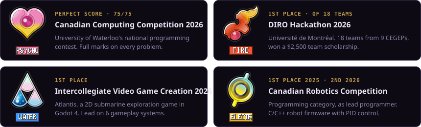
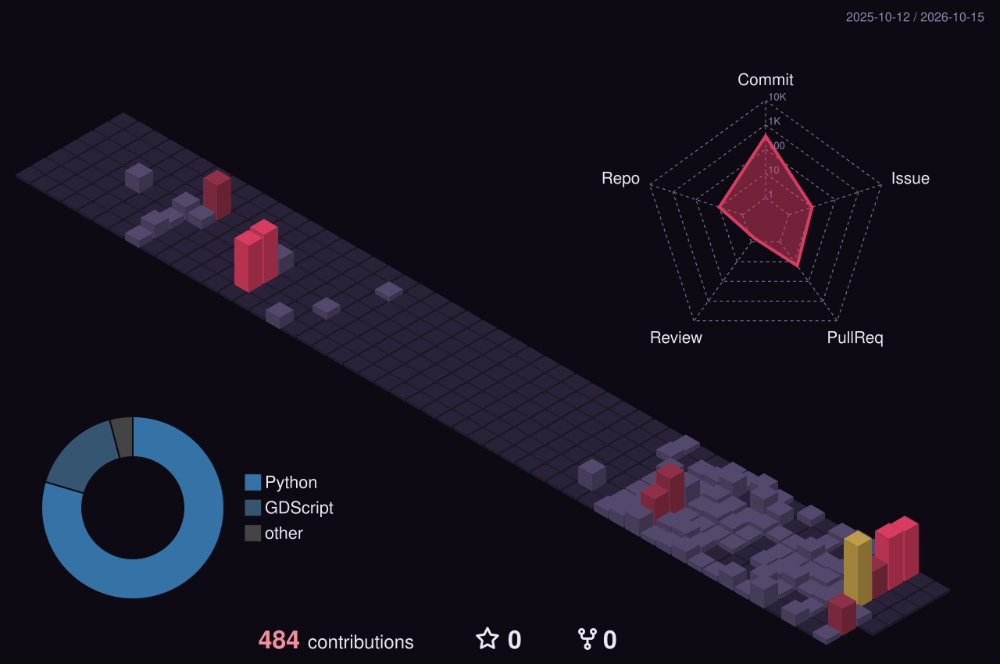

<picture>
  <source media="(prefers-color-scheme: dark)" srcset="assets/header-dark.svg">
  <source media="(prefers-color-scheme: light)" srcset="assets/header-light.svg">
  
</picture>

<picture>
  <source media="(prefers-color-scheme: dark)" srcset="assets/terminal-dark.svg">
  <source media="(prefers-color-scheme: light)" srcset="assets/terminal-light.svg">
  
</picture>

  <picture>
    <source media="(prefers-color-scheme: dark)" srcset="assets/typing-dark.svg">
    <source media="(prefers-color-scheme: light)" srcset="assets/typing-light.svg">
    
  </picture>

## Badges earned

<picture>
  <source media="(prefers-color-scheme: dark)" srcset="assets/badges-dark.svg">
  <source media="(prefers-color-scheme: light)" srcset="assets/badges-light.svg">
  
</picture>

## A wild Caterpie appeared!

<picture>
  <source media="(prefers-color-scheme: dark)" srcset="assets/battle-dark.svg?v=4">
  <source media="(prefers-color-scheme: light)" srcset="assets/battle-light.svg?v=4">
  
</picture>

  <b>Pick a move:</b>&nbsp;
  <a href="https://github.com/Yahya-github/Yahya-github/issues/new?title=battle%7Cfoul-play&body=Press+%22Create%22+to+use+Foul+Play.+The+battle+updates+in+about+a+minute.">Foul Play</a> ·
  <a href="https://github.com/Yahya-github/Yahya-github/issues/new?title=battle%7Cknock-off&body=Press+%22Create%22+to+use+Knock+Off.+The+battle+updates+in+about+a+minute.">Knock Off</a> ·
  <a href="https://github.com/Yahya-github/Yahya-github/issues/new?title=battle%7Cwill-o-wisp&body=Press+%22Create%22+to+use+Will-O-Wisp.+The+battle+updates+in+about+a+minute.">Will-O-Wisp</a> ·
  <a href="https://github.com/Yahya-github/Yahya-github/issues/new?title=battle%7Crecover&body=Press+%22Create%22+to+use+Recover.+The+battle+updates+in+about+a+minute.">Recover</a>
   Each move opens an issue. A GitHub Action plays the turn, redraws the battle and closes the issue.

<!--BATTLE:START-->
<table><tr><td valign="top">

**Last moves**

| Trainer | Move | Damage |
|:--|:--|--:|
| [@Yahya-github](https://github.com/Yahya-github) | Will-O-Wisp | 6 |
| [@Yahya-github](https://github.com/Yahya-github) | Knock Off | 29 |
| [@Yahya-github](https://github.com/Yahya-github) | Knock Off | 28 |
| [@Yahya-github](https://github.com/Yahya-github) | Foul Play | 16 |

</td><td valign="top">

**Top trainers**

| Trainer | KOs | Damage |
|:--|--:|--:|
| [@Yahya-github](https://github.com/Yahya-github) | 0 | 79 |

</td></tr></table>
<!--BATTLE:END-->

## Live stats

<picture>
  <source media="(prefers-color-scheme: dark)" srcset="assets/stats-dark.svg">
  <source media="(prefers-color-scheme: light)" srcset="assets/stats-light.svg">
  
</picture>

<picture>
  <source media="(prefers-color-scheme: dark)" srcset="https://raw.githubusercontent.com/Yahya-github/Yahya-github/output/snake-dark.svg">
  <source media="(prefers-color-scheme: light)" srcset="https://raw.githubusercontent.com/Yahya-github/Yahya-github/output/snake-light.svg">
  
</picture>

<picture>
  <source media="(prefers-color-scheme: dark)" srcset="profile-3d-contrib/profile-sableye-dark.svg">
  <source media="(prefers-color-scheme: light)" srcset="profile-3d-contrib/profile-sableye-light.svg">
  
</picture>

  <picture>
    <source media="(prefers-color-scheme: dark)" srcset="assets/skills-dark.svg">
    <source media="(prefers-color-scheme: light)" srcset="assets/skills-light.svg">
    
  </picture>

  

<picture>
  <source media="(prefers-color-scheme: dark)" srcset="assets/footer-dark.svg">
  <source media="(prefers-color-scheme: light)" srcset="assets/footer-light.svg">
  
</picture>

Sprites: Pokémon Showdown &amp; PokeAPI · Badge art: Bulbapedia · Pokémon © Nintendo / Game Freak / Creatures. Fan tribute, not affiliated.

